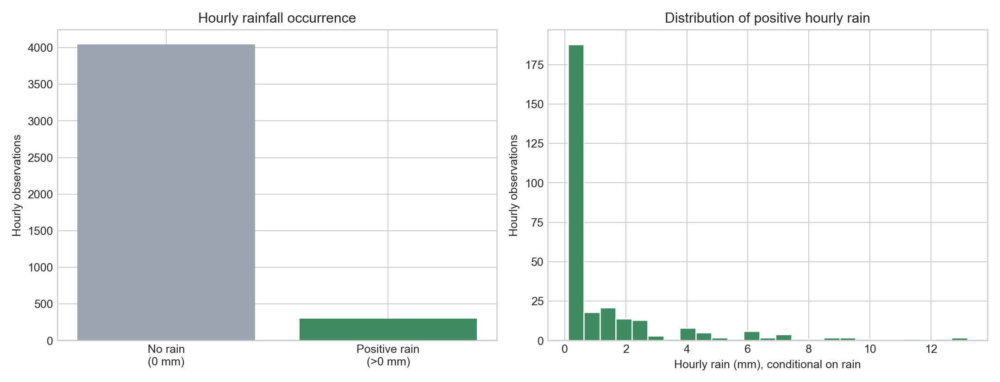
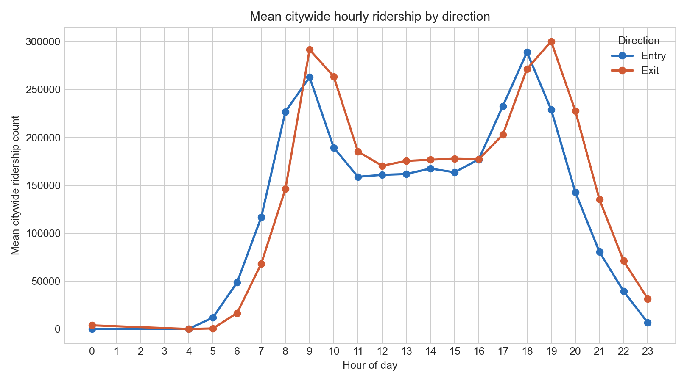
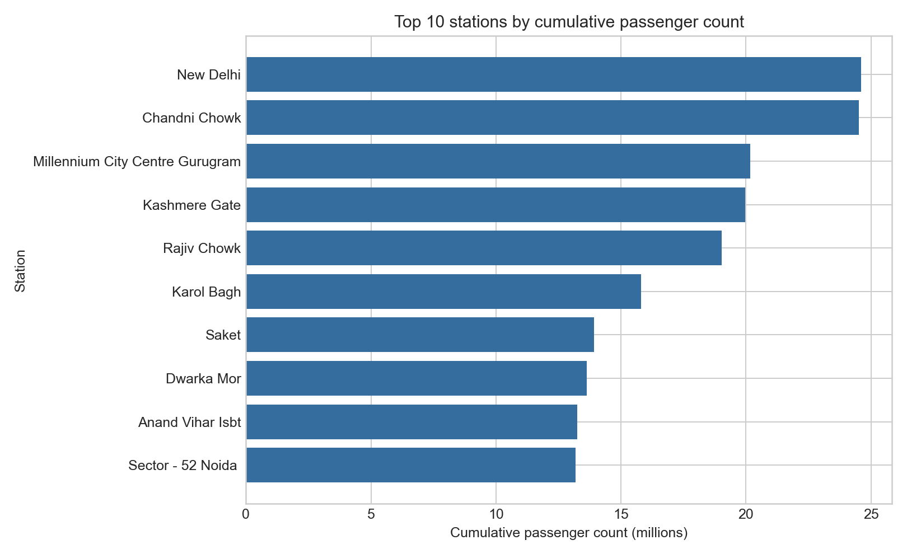
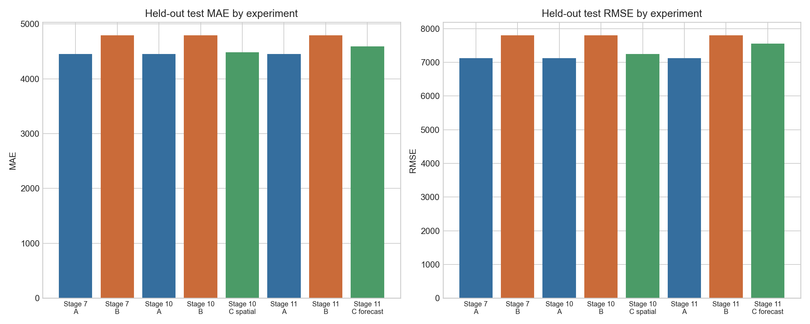
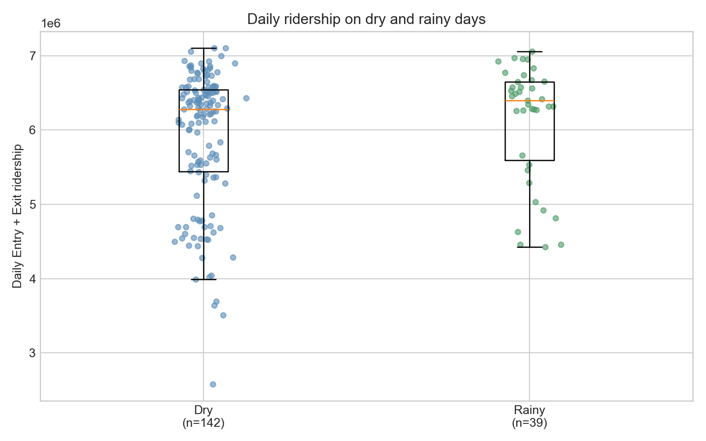
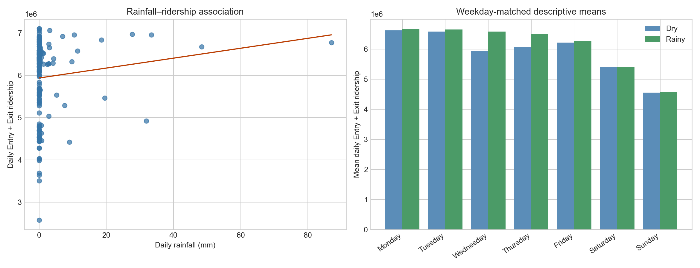

# Delhi Metro Ridership and Weather Research: Final Report

## Executive summary

This study examines Delhi Metro ridership from September 2024 through February 2025 and asks whether weather—especially rainfall—adds useful information to short-horizon ridership prediction or is associated with daily ridership differences. The evidence is observational and predictive, not causal.

The strongest tested hourly model without weather was the temporal-and-history Random Forest (Model A), with held-out test MAE **4,449.933** and RMSE **7,127.349** across 810 citywide direction-hour rows. The validation-selected observed-weather Random Forest (Model B) had higher held-out error: MAE **4,794.908** and RMSE **7,804.432**. Adding five-location spatial rainfall (Model C) was closer to Model A, but still worse: MAE **4,480.979** and RMSE **7,246.163**. A genuine one-hour-ahead forecast-rain variant also did not improve on Model A (MAE **4,589.521**, RMSE **7,557.056**).

At the daily level, mean recorded Entry + Exit ridership was 3.48% higher on rainy days than dry days, but the difference was not statistically significant (Welch *p* = 0.171; weekday-adjusted *p* = 0.0623). These results do not show that rain causes ridership to increase or decrease.

## 1. Research question and scope

### Primary questions

1. What temporal, directional, station, and line-level ridership patterns are present in the supplied Delhi Metro data?
2. Does adding observed weather, spatial rainfall, or forecast-available rainfall improve one-hour-ahead citywide ridership prediction relative to a temporal-and-history baseline?
3. Do daily citywide Entry + Exit totals differ between rainy and dry days in the available data?

### Scope and study unit

- **Study period:** 1 September 2024–28 February 2025.
- **Raw ridership unit:** station-hour passenger counts, retained separately for Entry and Exit.
- **Forecast target:** citywide `ridership_count`, formed by summing station counts at each `(time, direction)`; Entry and Exit remain separate target rows.
- **Weather representation:** existing Rajiv Chowk-aligned hourly weather for the observed-weather work; five-location rainfall for the spatial experiment; archived ECMWF IFS HRES single-run rainfall for the forecast-weather experiment.
- **Out of scope:** no completed regional weather forecasting result exists. Station/line geography is descriptive only, not evidence of region-level predictive performance.

## 2. Data and preparation (Stages 1–4)

### Ridership data

The source workbook covers six monthly Entry and Exit sheets. The assembled master data contain **1,872,465 station-hour records**: **936,243 Entry** and **936,222 Exit** records. The 21-row difference occurs in December and is less than 0.003% of the raw records.

The documented passenger totals are **518,847,146 Entry** and **559,994,662 Exit** counts. Exit totals are therefore higher by approximately **41.15 million** (about **7.9%**) in the supplied data; this difference was retained rather than corrected because the prior validation found no preprocessing explanation.

The citywide weather-merged file has **7,602 `(time, direction)` rows** (3,801 timestamps × 2 directions) and no missing merged weather fields. Metro operating rows are absent for 01:00–03:00; these are not treated as zero-ridership hours.

### Weather data and alignment

The existing hourly weather integration contains rain/precipitation, temperature, humidity, apparent temperature, WMO weather code, pressure, cloud cover, visibility, and wind speed. The weather and citywide targets were joined by exact hourly timestamp using a many-to-one validation. The feature audit reports that `precipitation_mm` and `rain_mm` are exact duplicates, so they were not treated as separate rainfall measures.

**Finding:** the merged citywide dataset has no missing basic meteorological inputs. Across its rows, `rain_mm` is zero for **92.87%** of observations; there are **542 positive-rain rows** and maximum hourly rain is **13.2 mm**. Figure 1 visualizes this sparse, zero-inflated distribution, which is important when interpreting rain-stratified results.

**Figure 1. Hourly rainfall distribution in the existing cleaned weather series.** The left panel makes the zero inflation explicit; the right panel shows only positive hourly rain. Sparse positive and especially heavy-rain observations constrain inference about rainfall intensity.

### Design assumptions versus established findings

| Item | Status | Treatment in this report |
|---|---|---|
| Metro operating hours exclude 01:00–03:00 | Verified in prepared data/audit | Treated as absent observations, not zeros. |
| Observed-weather timestamp merge | Verified exact timestamp merge | Appropriate for retrospective association/prediction evaluation, not operational forecasting. |
| `HRn` interval convention for Stage 11 | **User-specified assumption**: `[n:00, (n+1):00)` IST | Used only for the forecast-rain interval alignment; source workbook documentation did not independently establish it. |
| IFS run availability | Conservative assumption: initialization + 6 hours | Not a verified historical publication timestamp. |

## 3. Exploratory findings (Stages 1–5)

### Temporal and directional EDA

Existing EDA documents a bimodal commuting pattern: demand rises rapidly after 06:00, has a morning peak around 09:00, declines in the afternoon, and has a slightly larger evening peak around 18:00. Figure 2 visualizes this pattern by direction. Ridership falls after 20:00, with low observed movement overnight. These are descriptive findings from the supplied data, not causal effects of time of day.

**Figure 2. Mean citywide hourly ridership by direction.** The saved citywide direction-hour data show the documented commuter peaks and broadly similar Entry/Exit timing; this is a descriptive average over the study period.

Exit counts exceed Entry counts in every documented month and metro line. Average station-hour counts are **554.18** (median 287, maximum 13,486) for Entry and **598.14** (median 306, maximum 15,152) for Exit. The mean exceeding the median in both directions indicates right-skewed station-hour counts.

### Station and line EDA

The documented top ten stations by cumulative volume are New Delhi, Chandni Chowk, Millennium City Centre Gurugram, Kashmere Gate, Rajiv Chowk, Karol Bagh, Saket, Dwarka Mor, Anand Vihar ISBT, and Sector-52 Noida; Figure 3 shows their stored cumulative totals. `LINE02` has the highest reported cumulative volume, `LINE03` second; RMGL (Airport Express) is the lowest among the documented major lines. These are descriptive rankings only.

**Figure 3. Top ten stations by cumulative passenger count.** The ranking visualizes the existing station-level totals and illustrates the concentration of measured demand at major interchange, commercial, and residential hubs; it does not control for station characteristics or exposure.

## 4. Feature engineering and validation (Stage 6)

### Features

Model A uses 13 predictors: direction; month; peak-hour indicator; cyclic hour and day-of-week encodings; ridership lags of 1, 2, 3, and 24 hours; and preceding 6- and 24-hour ridership rolling means. Model B adds 15 observed same-hour/lagged Rajiv Chowk weather and rainfall-history features.

Feature construction was audited for availability: rainfall lags and rainfall rolling sums were calculated on the complete hourly weather timeline before joining to metro rows; historical ridership features use earlier timestamps. The audit found no target leakage for a rolling one-step-ahead setting. It also noted that actual earlier test-period ridership is used in lag features, so this setup is **not** a fixed-origin multi-step forecast evaluation.

### Chronological evaluation protocol

Eligible rows were split chronologically, retaining paired Entry/Exit targets at each timestamp:

| Split | Rows | Timestamps | Period |
|---|---:|---:|---|
| Train | 3,780 | 1,890 | 2024-09-02 to 2025-01-05 |
| Validation | 810 | 405 | 2025-01-06 to 2025-02-01 |
| Test | 810 | 405 | 2025-02-02 to 2025-02-28 |

The audit verified no duplicate keys, complete predictors in the prepared partitions, and exact target/key alignment among compared saved predictions. Hyperparameter/model selection used validation MAE, with RMSE as the documented tie-break; test was reserved for final reporting.

## 5. Forecasting results (Stages 5–9)

### Baselines and linear ablation

All figures below are held-out test results on the identical 810 row `(time, direction)` sample.

| Stage | Model | MAE | RMSE | Interpretation |
|---|---|---:|---:|---|
| 5 | Linear regression baseline | 15,808.969 | 21,902.349 | Validation-selected Stage 5 baseline. |
| 5 | Seasonal naive, 24 h | 22,585.715 | 42,670.234 | Uses prior-day corresponding time. |
| 5 | Naive previous observation | 37,784.359 | 50,584.197 | Weak simple baseline. |
| 5 | Moving average, 3 h | 62,150.890 | 80,152.984 | Weak simple baseline. |
| 5 | Moving average, 6 h | 77,815.160 | 97,245.459 | Weak simple baseline. |
| 5 | Moving average, 24 h | 67,061.802 | 85,512.694 | Weak simple baseline. |
| 6 | Linear A: temporal + history | 15,870.572 | 21,703.635 | No observed weather. |
| 6 | Linear B: A + observed weather | 15,861.764 | 21,788.451 | MAE changes by −8.808, RMSE by +84.816 versus linear A. |

The large MAE reduction achieved by the later Random Forest models is not an isolated weather effect: it changes estimator family and nonlinear feature handling. The saved comparability audit verified that the Stage 5/Stage 7 gap is not due to a target, join, units, or test-key mismatch.

### Advanced models

| Model | Validation MAE | Validation RMSE | Test MAE | Test RMSE |
|---|---:|---:|---:|---:|
| Seasonal naive, 24 h | 15,899.325 | 33,482.029 | 22,585.715 | 42,670.234 |
| HistGradientBoosting A: temporal + history | 6,271.643 | 9,789.256 | 4,702.929 | 6,965.695 |
| HistGradientBoosting B: A + observed weather | 6,751.120 | 10,088.203 | 5,112.383 | 7,569.096 |
| RandomForest A: temporal + history | 5,849.316 | 10,107.701 | **4,449.933** | **7,127.349** |
| RandomForest B: A + observed weather | **5,778.637** | **10,106.005** | 4,794.908 | 7,804.432 |
| SARIMAX, no weather | 30,022.451 | 40,722.976 | 33,665.683 | 44,273.315 |

RandomForest B was selected under the validation-only rule because it had the lowest validation MAE. It was then refit on train + validation and evaluated on test. Its test result is worse than RandomForest A; this does not retroactively change the validation-based selection.

Figure 4 consolidates the saved held-out MAE and RMSE comparisons for the Random Forest weather experiments in Stages 7, 10, and 11. It is a visual comparison of the already reported test metrics, not a new evaluation.

**Figure 4. Held-out MAE and RMSE across the Stage 7, 10, and 11 Random Forest experiments.** In each experiment, no-weather Model A has the lowest aggregate held-out error. Observed weather (B), spatial rainfall (Stage 10 C), and forecast rainfall (Stage 11 C) do not surpass A on this test set.

### What the observed-weather comparison shows

On test, observed weather changed RandomForest MAE by **+344.974** and RMSE by **+677.084** relative to no-weather Model A. For HistGradientBoosting, observed weather changed MAE by **+409.455** and RMSE by **+603.400**. Thus, observed same-hour weather did not improve the aggregate held-out performance of these nonlinear models.

Rain-stratified RandomForest test results are sparse: 778 no-rain rows, 30 light-rain rows, 2 moderate-rain rows, and 0 heavy-rain rows. On light rain, observed-weather Model B had lower MAE than A (4,309.062 vs 4,539.426), but the moderate-rain sample is only two rows and there are no heavy-rain rows. This is insufficient evidence for reliable intensity-specific conclusions.

For the saved observed-weather RF on test, Entry MAE/RMSE are 4,483.145/7,065.378 and Exit MAE/RMSE are 5,106.670/8,479.314. The corresponding no-weather RF errors are 4,154.765/6,571.723 (Entry) and 4,745.102/7,642.686 (Exit).

## 6. Spatial observed-weather experiment (Stage 10)

Stage 10 tested a controlled spatial-rain Model C: Model A features plus ten spatial-only rainfall features from five locations; it deliberately excluded Rajiv Chowk weather fields. Key/target alignment, feature ordering, null-free inputs, and the original chronological splits were verified. Model C used the Stage 7 Random Forest configurations and was selected on validation only before train+validation refitting.

| Test model | MAE | RMSE | MAE change vs A |
|---|---:|---:|---:|
| A: temporal + history | **4,449.933** | **7,127.349** | 0.000 |
| B: Rajiv Chowk observed weather | 4,794.908 | 7,804.432 | +344.974 |
| C: spatial rainfall only | 4,480.979 | 7,246.163 | +31.046 |

Spatial Model C was better than B but still worse than the no-weather A on the aggregate test. Direction-specific C MAE was 4,173.862 for Entry and 4,788.096 for Exit, compared with A's 4,154.765 and 4,745.102. In the spatial rain bands, heavy rain had zero test rows, so no heavy-rain conclusion is supported.

This is a **retrospective** comparison because B and C use observed same-hour weather. It does not measure operational forecast skill and makes no causal claim.

## 7. One-hour-ahead forecast-weather experiment (Stage 11)

Stage 11 replaces observed weather in the experimental weather model with archived Open-Meteo Single Runs API ECMWF IFS HRES rainfall for Rajiv Chowk. For a target interval `[T, T+1h)`, the decision time was `T−1h`. A run was accepted only when assumed availability (initialization + 6 h) was no later than the decision time. Forecast bins ending at `T+00:30` and `T+01:30` were each weighted by one-half to form rainfall over `[T, T+1h)`; no timestamp rounding was used.

Model C contains the A features plus forecast rainfall, forecast-rain lags (1/2/3 h), and preceding forecast-rain sums (3/6/12/24 h). It was selected on validation MAE (option 1), refit on train + validation, and evaluated once on the unchanged test rows.

| Test model | MAE | RMSE | MAE change vs A |
|---|---:|---:|---:|
| A: no weather | **4,449.933** | **7,127.349** | 0.000 |
| B: observed same-hour multi-weather | 4,794.908 | 7,804.432 | +344.974 |
| C: forecast rainfall | 4,589.521 | 7,557.056 | +139.587 |

Forecast-rain C is better than retrospective B on this test but does not outperform no-weather A. Its Entry MAE/RMSE is 4,210.184/6,669.065; Exit is 4,968.858/8,351.154. The availability rule is conservative, but the six-hour delay is an assumption rather than a verified historical dissemination time; the Metro `HRn` interval convention is also an explicit study assumption.

## 8. Daily rainfall versus daily ridership (Stage 12)

Stage 12 aggregates the existing citywide series by date. Every date has the same available coverage: 21 hourly weather observations and 42 Entry/Exit ridership rows. Daily rain is the sum of Rajiv Chowk-aligned `rain_mm` across available hours; rainy means daily rain > 0 mm. This is a descriptive observational analysis, not an intervention analysis.

| Quantity | Result |
|---|---:|
| Days | 181 |
| Dry days | 142 |
| Rainy days | 39 |
| Mean dry-day Entry + Exit total | 5,916,127 |
| Mean rainy-day Entry + Exit total | 6,121,841 |
| Rainy minus dry | +205,714 (+3.48%) |
| Cohen's *d* | 0.231 |
| Welch two-sided test | *t* = 1.383, *p* = 0.1710 |
| Mann–Whitney two-sided test | *p* = 0.1649 |

The equal-weekday-average rainy-minus-dry difference was **+174,336** (+2.95%) across all seven weekdays with both types of observations. An OLS comparison controlling for weekday estimated **+195,925**, *p* = **0.06231**. Figure 5 shows the underlying dry/rainy distribution. Neither the overall test nor the weekday-adjusted result is significant at the conventional 0.05 threshold.

**Figure 5. Daily citywide Entry + Exit ridership on dry and rainy days.** The rainy-day mean is higher in this sample, but the overlapping distributions and reported tests show that the difference is not statistically significant at 0.05.

Daily rainfall–ridership associations were weak and non-significant: Pearson *r* = **0.114**, *p* = **0.1281**; Spearman rho = **0.119**, *p* = **0.1097**. Figure 6 pairs the scatterplot with weekday-matched descriptive means. The three unavailable overnight hours, holidays, service changes, seasonality, special events, rainfall timing/intensity, and small rainy-day strata limit interpretation.

**Figure 6. Daily rainfall association and weekday-matched descriptive means.** The scatterplot is consistent with the weak, non-significant correlations, while the weekday panel illustrates descriptive mean differences rather than a causal adjustment.

## 9. Limitations and threats to interpretation

1. **Observational data:** all rainfall/ridership comparisons are associations, not evidence that rainfall causes a change in demand.
2. **Same-hour observed weather:** Models B and Stage 10 C use weather observed in the target hour. Their results are retrospective and cannot establish operational forecast performance.
3. **Forecast-weather assumptions:** Stage 11 improves weather availability discipline, but uses an assumed six-hour run delay and a user-specified `HRn` interval convention not independently documented by the source workbook. Half-hour overlap weighting assumes uniform rain inside each hourly forecast bin.
4. **Weather sparsity:** rain is zero in 92.87% of hourly rows, and heavy-rain test samples are absent. Rain-intensity findings beyond light rain are not reliable.
5. **One-step historical updating:** prior actual ridership is used for historical lag features. This is suitable only if each prior observation is available at the next prediction time, not for fixed-origin multi-step forecasting.
6. **Daily coverage:** daily analysis consistently excludes three overnight hours and uses a single Rajiv Chowk-aligned weather series.
7. **Potential confounding:** weekday adjustment is limited. Holidays, service disruptions, seasonal change, air quality, special events, and other unmeasured influences may affect ridership and correlate with weather.
8. **Spatial/generalization limits:** the five-location input has complete timestamps, but requested coordinates for four locations were not independently verifiable from a separate request manifest. No completed region-level forecasting results exist.
9. **Data provenance/availability:** the project documents Delhi Transport Stack as the data source and states that raw data cannot be shared; results should be reproduced from the saved project artifacts where access permits.

## 10. Conclusions

1. The supplied data show clear commuter-time structure, persistent Exit-over-Entry counts, and concentrated demand at major stations/lines.
2. Historical ridership and temporal structure are highly predictive at the evaluated one-step horizon: the no-weather Random Forest A is the best aggregate held-out model among the reported experiments, with MAE 4,449.933 and RMSE 7,127.349.
3. Adding observed Rajiv Chowk weather, five-location spatial rainfall, or conservatively available forecast rainfall did **not** improve aggregate held-out performance over Model A. This is a result for this dataset, period, features, and evaluation design—not proof that weather never matters for metro demand.
4. The daily rainy-versus-dry comparison found higher mean recorded ridership on rainy days, but the difference and rainfall correlations were not statistically significant. It therefore provides no reliable evidence of a daily rainfall effect.
5. Future work should use independently documented interval semantics and forecast issuance times, longer multi-season samples with more rain events, richer external controls, and a rolling operational evaluation. Any causal question requires a design that addresses confounding rather than a predictive feature comparison alone.

## 11. Artifact index

- Data/EDA documentation: `Documents/OBSERVATION.md`, `Documents/VERSIONS.md`, and Notebooks 01–05.
- Feature and evaluation audit: `Documents/model_specification_audit.md`, prepared split CSVs, and Notebooks 06–11.
- Consolidated Stage 5–9 metrics: `DataProcessed/stage9_consolidated_metrics.csv`, `stage9_validation_selection_summary.csv`, and `stage9_weather_contribution_summary.csv`.
- Spatial experiment: `DataProcessed/stage10_spatial_weather_results.csv` and `stage10_spatial_weather_summary.md`.
- Forecast-weather experiment: `DataProcessed/stage11_forecast_weather_results.csv`, `stage11_forecast_weather_report.md`, forecast features, predictions, and model artifact.
- Daily analysis: `DataProcessed/stage12_daily_rainfall_ridership_report.md`, results/daily CSVs, plots, and `Notebooks/12_Daily_Rainfall_Ridership_Analysis.ipynb`.
